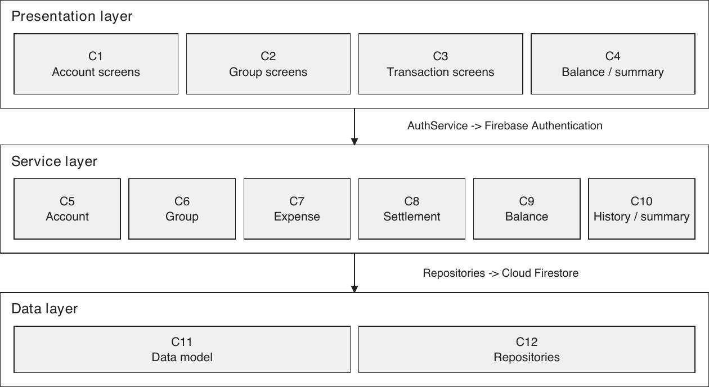
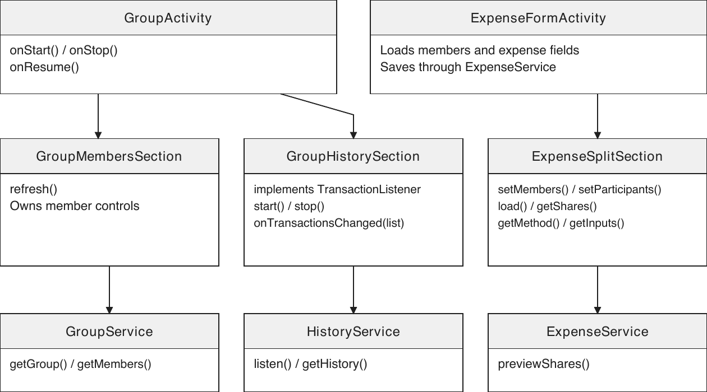
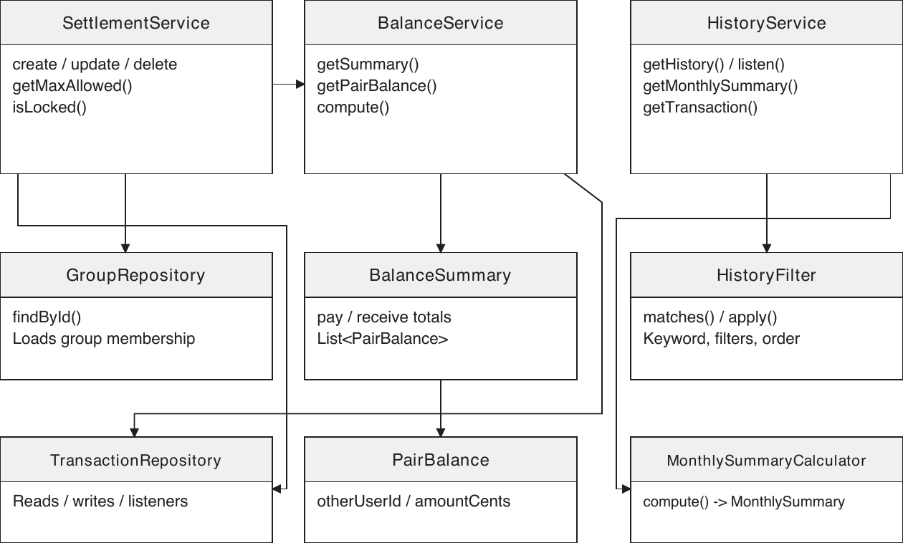
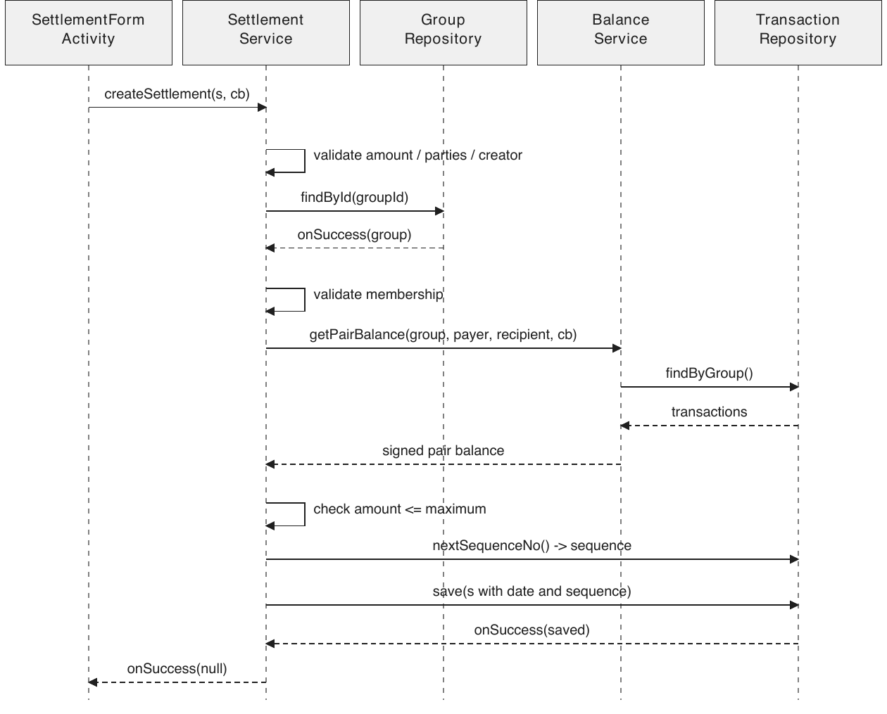
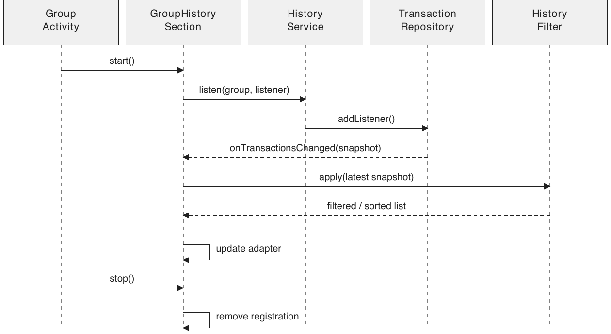

# SplitSmart

Project 2.3: Implementation

Team 19

## 1 Project Title and Authors

Project title: SplitSmart (Project A)

Team number: Team 19

Customer: TA Yuzhou Fang

Team members:

Chenyang Wang, cwang120@usc.edu

Alina Du, alinadu@usc.edu

Dawi Yoon, dawiyoon@usc.edu

William Wang, wwang767@usc.edu

Yang Chen, ychen529@usc.edu

## 2 Preface

SplitSmart is an Android application that helps USC students and alumni record shared expenses, work out who owes whom, and record payments made outside the app. It provides one place for roommates, friends, and student organizations who regularly split expenses. SplitSmart does not send or receive money and is meant to be used alongside payment applications like Venmo.

This document describes the implementation of SplitSmart based on the requirements in Project 2.1 and the design in Project 2.2. It explains what changed during implementation and why, and presents the revised architecture and detailed design. The intended readers are the customer, the teaching staff, and team members who will maintain the application.

## 3 Introduction

### 3.1 Main Functions

The application provides the five functions described in the earlier documents: accounts and groups, expenses and splitting, balances, settlements, and history and summaries. Members can split an expense equally, by exact amounts, or by percentages. They can then review separate totals for what they owe and what they should receive, record repayments, and look up earlier transactions.

### 3.2 Organization of This Document

Section 4 describes the architectural changes and the component mapping. Section 5 explains the detailed changes with revised class and sequence diagrams. Section 6 identifies differences from the original requirements and explains their effects on the design. Retained design decisions are identified separately from changes and implementation details.

<!-- pagebreak -->

## 4 Architectural Design Change

### 4.1 Architectural Style and Major Components

The three-layer architecture from Project 2.2 is retained. The presentation layer displays information and collects input. The service layer applies the business rules, and the data layer stores and retrieves records. Firebase Authentication checks account credentials, while Cloud Firestore stores profiles, groups, expenses, and settlements. The twelve components keep their original feature responsibilities.

### 4.2 Change: Dividing Large Screens into Sections

In Project 2.2, GroupActivity was responsible for the group page and its transaction listener. In the implementation, GroupMembersSection handles the member controls and GroupHistorySection handles the transaction list, filters, and listener. GroupActivity holds these sections and opens the other screens. ExpenseFormActivity similarly delegates split inputs and previews to ExpenseSplitSection.

We made this change because the member list, history, and split inputs have different reasons to change. Keeping them in separate classes made it easier to work on the features without repeatedly editing one large activity. These classes still belong to the presentation layer, so the change does not introduce another layer.

### 4.3 Retained Design: Services Own the Rules

Balance calculation, expense validation, settlement validation, and locking remain in services. A screen can hide an action that is not allowed, but the service checks the saved record again before changing it. This keeps the rule consistent when a screen was opened before another transaction changed the group.

<!-- pagebreak -->

### 4.4 Revised Mapping of Classes to Components

The table below updates the class mapping in Project 2.2. The section classes and MonthlySummaryCalculator are the main additions; the remaining feature boundaries are retained.

| Component | Classes in the implementation |
| --- | --- |
| C1 Account Screens | LoginActivity, RegisterActivity, ProfileActivity |
| C2 Group Screens | GroupListActivity, GroupFormActivity, GroupActivity; added GroupMembersSection and GroupHistorySection |
| C3 Transaction Screens | ExpenseFormActivity, SettlementFormActivity, TransactionDetailActivity; added ExpenseSplitSection |
| C4 Balance and Summary Screens | BalanceActivity, MonthlySummaryActivity |
| C5 Account Service | AuthService; ValidationException is also used by the other services |
| C6 Group Service | GroupService |
| C7 Expense Service | ExpenseService, SplitStrategyFactory, SplitStrategy, EqualSplit, ExactAmountSplit, PercentageSplit |
| C8 Settlement Service | SettlementService |
| C9 Balance Service | BalanceService, BalanceSummary, PairBalance |
| C10 History and Summary Service | HistoryService, HistoryFilter, MonthlySummary; added MonthlySummaryCalculator |
| C11 Data Model | User, Group, Transaction, Expense, Settlement, Category, SplitMethod |
| C12 Data Access | UserRepository, GroupRepository, TransactionRepository, TransactionListener |

### 4.5 Implementation Detail: Callbacks and Screen Lifecycles

The sequence diagrams in Project 2.2 already described callback responses. The implementation makes this contract explicit through Callback<T>, with separate onSuccess and onFailure methods. ValidationException names the problem field so that the form can display the message beside the corresponding input.

The history, balance, and monthly-summary screens add transaction listeners on start and remove them on stop. History, balance, and settlement screens also reject stale asynchronous responses, preventing an earlier read from replacing newer information or updating a stopped screen. Transaction forms disable Save while loading or writing.

### 4.6 Implementation Detail: Storage

Firestore stores users at users/{uid}, groups at groups/{groupId}, and expenses and settlements together at groups/{groupId}/transactions/{id}, distinguished by type. A Firestore transaction increments seqCounter to assign sequence numbers. For manually prepared records, TransactionRepository fills missing IDs from the document ID and parent group path when reading. It preserves existing values and does not write this fallback to storage.

<!-- pagebreak -->

## 5 Detailed Design Change

### 5.1 Change: Presentation Classes and Their Responsibilities

Figure 2 shows the new section classes and the main calls between them. GroupHistorySection now implements TransactionListener instead of GroupActivity. GroupActivity forwards start and stop events to it and refreshes GroupMembersSection when the group page resumes. ExpenseFormActivity supplies the amount, payer, and selected participants to ExpenseSplitSection.

ExpenseSplitSection keeps the selected split method, the entered values, and the share preview together. Its getShares method either returns valid shares or throws ValidationException. This lets the form use the same result that the user has just reviewed, instead of calculating the split again in another place.

The group overview, history heading, and filters are list headers, so they scroll with the transaction rows. This addresses a layout problem found during integration: the owner's controls could otherwise leave too little space for the history. It changes the layout of the group page without changing the stored data or the group's permissions.

### 5.2 Change: Preserving the Inputs Used for a Split

Expense stores both shares and splitInputs. The shares map holds the final whole-cent amount for each participant. The splitInputs map holds the entered dollar amounts or percentages, and is empty for an equal split. ExpenseSplitSection.load restores these values when the creator edits an expense.

The two maps serve different purposes. Rounded shares are the values used to calculate debt, but they are not always enough to reconstruct the percentages that the member originally typed. Keeping the inputs avoids changing those entries merely because an expense was reopened for editing.

<!-- pagebreak -->

### 5.3 Revised Service Classes and Result Objects

Figure 3 shows the service relationships used by the implemented balance, settlement, and history features. The division between these services is retained from Project 2.2. The pure calculation entry point in BalanceService, the protected result list in BalanceSummary, and the separate MonthlySummaryCalculator are implementation refinements.

BalanceService.compute calculates a BalanceSummary from a group's transaction snapshot. A positive pair balance means that the other member owes the user; a negative value means that the user owes the other member. The service returns the nonzero pairs and two separate totals. BalanceActivity adds a settled row for other group members with no outstanding amount. BalanceSummary copies its list and exposes it as unmodifiable, so a screen cannot accidentally change the result.

The integer-cent representation and pairwise rules are retained design decisions. Opposite debts between the same two people cancel, but debts are never transferred through a third person. A settlement changes only the pair between its payer and recipient. Arithmetic overflow is reported instead of returning an incorrect wrapped amount.

HistoryFilter.apply performs the matching and ordering used by both service reads and the live list. MonthlySummaryCalculator.compute contains the monthly arithmetic without depending on Firebase. Moving this calculation into its own class makes it possible to test category totals, expense counts, and exclusion of settlements directly.

<!-- pagebreak -->

### 5.4 Implementation Detail: Recording a Settlement

The settlement form lists only members who have an outstanding balance in the chosen direction. SettlementService checks the amount, the parties, the creator, and group membership before saving. It uses BalanceService.getPairBalance to find what the payer owes the recipient. The largest allowed amount is max(0, -pairBalance). Figure 4 shows the successful flow after each check passes.

### 5.5 Implementation Detail: Editing a Settlement

The service first loads the saved settlement and checks its creator. Only the amount and note can be changed, as described in UC-4. The original parties, creator, creation date, and sequence number are kept. For saved amount S and current signed pair balance B from the payer's perspective, the editing limit is max(0, S - B).

This calculation removes the old settlement's effect before checking the replacement. For example, if Alice owed Bob $11 and recorded a $5 payment, the current debt is $6, but the original settlement can still be edited up to $11. Removing the effect before clamping to zero also handles a later expense that reverses the direction of the debt.

<!-- pagebreak -->

### 5.6 Implementation Detail: Locking and Deletion

The locking policy is retained. SettlementService.isLocked reads the group's current transactions and looks for a settlement with a greater sequence number that connects the expense's payer to a different participant with a positive share. Either direction counts. A settlement between two participants who are not the expense's payer does not lock that expense. Section 6.3 explains the positive-share refinement to the original wording.

No lock flag is stored on an expense. Deleting a settlement therefore unlocks an expense when no other later settlement covers it. TransactionDetailActivity checks the rule before showing Edit or Delete, and ExpenseService checks it again before writing. Expense and settlement deletion also require confirmation on the detail screen and a creator check in the service.

### 5.7 Change: Shared History Processing and Monthly Calculation

The history section keeps the latest transaction snapshot and applies HistoryFilter whenever the keyword, type, category, member, or sort option changes. Filters are combined, and keyword matching is case-sensitive. Both sort directions use sequenceNo, so records saved on the same day still have a stable order.

MonthlySummaryActivity uses the same transaction-listener mechanism and passes the snapshot to MonthlySummaryCalculator for the selected month. The calculator counts only expenses and supplies a total for all five categories, including zero totals. Editing an expense keeps its creation date, so it stays in the same month's summary.

<!-- pagebreak -->

### 5.8 Implementation Detail: Data Integrity and Verification

Creating an expense or settlement assigns a sequence number and the device's local date. Editing preserves both. GroupRepository uses a merge when saving group information so that changing the group name does not reset seqCounter. Deleting a group also deletes its transaction documents, because deleting the Firestore parent alone would leave the subcollection behind.

ExpenseService checks that the creator, payer, and participants belong to the group, that the payer is a participant, and that nonnegative shares add up to the full amount. The creator need not participate in the expense. SettlementService separately checks that the creator is either the payer or the recipient. Update and delete operations use the saved record to check ownership rather than trusting a creator ID supplied by the form.

EqualSplit distributes remainder cents in participant order. ExactAmountSplit checks the entered amounts against the total. PercentageSplit uses decimal arithmetic, keeps 0% shares at zero, and distributes the remainder among participants with positive percentages. The accepted input tolerance is normalized before rounding so that a large expense still divides into exactly its total amount.

The complete application was built and checked on 4 November 2026. The results below apply to the application code in commit ec69c63, including the final repository and interface fixes and removal of developer tools.

| Check | Observed result |
| --- | --- |
| JVM unit tests | 81 tests passed, with no failures or errors. |
| Android instrumentation | 8 tests passed on an ARM64 Android 16 / API 36 emulator. |
| Application builds | Debug and unsigned Release APKs built successfully. |
| Android lint | No errors; 74 warnings remained, mainly for text resources and screen orientation. |

The tests cover split arithmetic, balance calculations, history filters, monthly totals, permissions, and settlement limits. The Android scenarios use the real Firebase SDKs with local backends and exercise expense forms, settlement creation and editing, confirmation dialogs, automatic balance updates, screen recreation, and a server-source read. One unit test and one Android test are the original template smoke checks; the remaining tests cover application behavior.

The run used one Android API level and local Firebase emulators. It did not test two physical devices, the deployed Firestore security rules, or simultaneous submissions from different clients. The debt check and settlement write remain separate operations, so concurrent submissions could race. Addressing that case would require an atomic backend operation or a transactional ledger design. Developer tools have been removed, and authentication now uses only the signed-in Firebase account. The shared test-mode rules still require review before a public release.

<!-- pagebreak -->

## 6 Requirements Change

### 6.1 FR-1.1: Password Length

The original requirement has no password-length rule. The implemented Firebase email/password flow requires at least six characters and reports a weak password beside the password field. This is a difference caused by the chosen authentication provider. It does not change the architecture, because AuthService already owns registration. At the detailed-design level, registration must handle the provider's password failure and explain the minimum to the user.

### 6.2 FR-2.4.3: Percentage Sum Tolerance

The original requirement says percentages add up to exactly 100. The implementation accepts a sum within 0.0001 percentage points of 100 and normalizes the accepted values before assigning whole cents. The reason is to tolerate a small numerical difference without changing the expense total. This affects PercentageSplit and its validation tests, but does not require a new component or a change to the data model.

### 6.3 FR-4.2: Zero-Share Participants and Locking

The original wording refers to an expense's participants without excluding zero shares. The team implementation refines the rule to positive shares: a participant assigned $0.00 creates no debt to the payer, so a settlement with that participant alone does not lock the expense. This changes the condition in SettlementService.isLocked and the corresponding tests. The locking policy and the dependency from ExpenseService to SettlementService remain the same.

### 6.4 UC-2 and UC-4: Form Interaction Differences

The following differences describe the current screens rather than changes to which records may be saved:

- UC-2 steps 5.2-5.4 describe disabling Save whenever inputs are invalid. The expense form instead shows split feedback while editing and rejects invalid input when Save is selected. Save is disabled while data is loading or a write is in progress. The service validation remains the final check. Matching the original button behavior would require the form to combine field and split validity before enabling Save; it would not change the service or storage design.
- UC-2 step 8.1.2 places the original creation date in the expense edit form. The current application shows it on the transaction detail screen instead. It is still preserved and cannot be edited. Adding the same read-only date to ExpenseFormActivity would be a presentation-only change.
- UC-4 step 1.1 says the settlement form does not open when there is no debt. The implementation opens the form and shows that there are no outstanding balances in the selected direction, with Save disabled. The member can switch direction on that screen. This changes the empty-state location, but leaves the balance and settlement rules unchanged.

### 6.5 Requirements Retained

All amounts remain in US dollars, settlements record payments made outside the app, and debts remain separate for each group and pair of members. Receipt scanning, multiple currencies, removing members, leaving groups, transferring ownership, and retaining deleted transactions remain outside the scope. The layered design still supports these boundaries; the implementation does not add external payment processing or USC-system integration.
