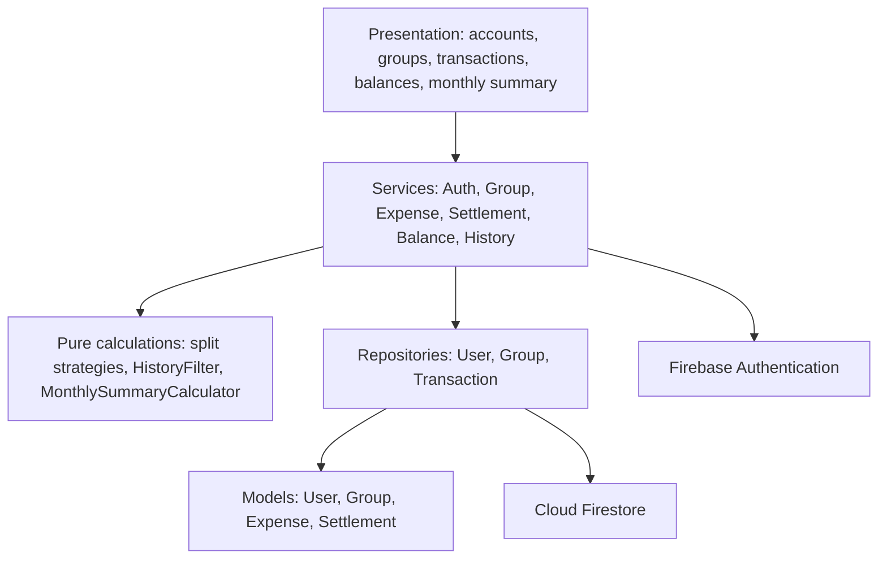
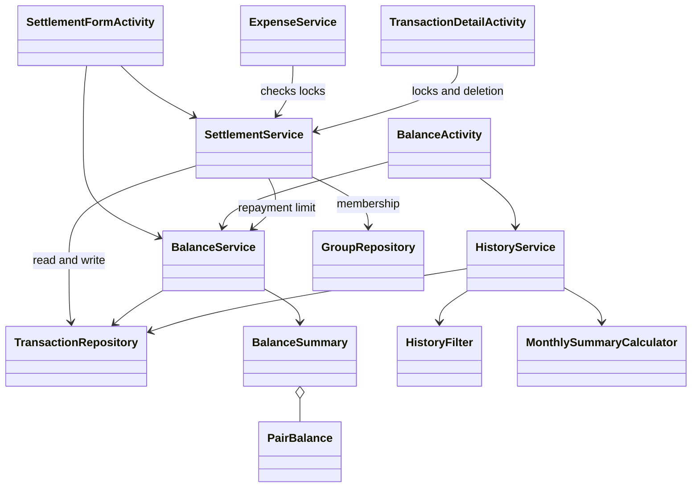
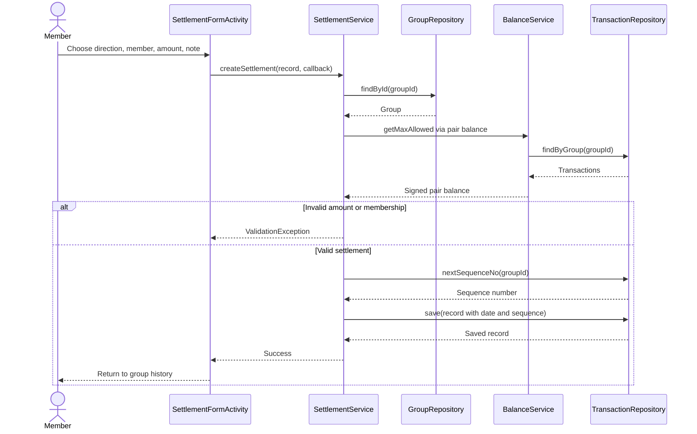

# SplitSmart

Project 2.3: Implementation · Team 19

## 1 Project Title and Authors

Project title: SplitSmart (Project A)
Team number: Team 19
Customer: TA Yuzhou Fang

| Team member | USC email |
| --- | --- |
| Chenyang Wang | cwang120@usc.edu |
| Alina Du | alinadu@usc.edu |
| Dawi Yoon | dawiyoon@usc.edu |
| William Wang | wwang767@usc.edu |
| Yang Chen | ychen529@usc.edu |

## 2 Preface

SplitSmart is an Android application for USC students and alumni who share expenses. It records expenses and payments made outside the app, divides each expense among its participants, and shows the balance between each pair of members. It does not transfer money.

This document describes the implementation and identifies changes and refinements to Project 2.2. It is intended for the customer, the teaching staff, and team members maintaining the application. The requirements in Project 2.1 remain the basis for the application, with the implementation differences stated in Section 6.

## 3 Introduction

The integrated application includes accounts and groups, expenses with three split methods, balances, settlements, transaction history, and monthly summaries. Parts A, B, C, and E were integrated before the Part D work described here. Part D completes the balance and settlement services and screens and connects the settled-expense policy to the existing expense and detail screens.

The project uses Java and Android XML layouts. Firebase Authentication handles email/password accounts, and Cloud Firestore stores profiles, groups, expenses, and settlements. Amounts are stored as whole cents. Each group's sequence counter gives transactions a stable order even when several have the same creation date.

The sections below distinguish architectural changes, detailed implementation changes, and requirement differences. The companion validation report describes the tests and their limits. A passing local test does not establish that a particular deployed Firestore ruleset or a second physical device has been verified.

## 4 Architectural Design Change

### 4.1 The three-layer structure is retained

The presentation, service, and data layers from Project 2.2 remain in place. Activities call services, services apply the business rules and use repositories, and repositories access Firestore. Authentication is the exception already identified in the design: AuthService also uses Firebase Authentication. No production screen added in Part D reads Firestore directly.

Figure 1. Revised implementation architecture. The arrows show dependencies, rather than every individual method call.

### 4.2 Screen responsibilities are split into sections

Project 2.2 placed the group page's transaction listener on GroupActivity. The implementation puts it in GroupHistorySection. GroupMembersSection owns the member controls, while GroupActivity forwards lifecycle events and handles navigation. ExpenseSplitSection similarly owns split inputs and previews inside ExpenseFormActivity.

This division let the team implement different parts without repeatedly changing the same activity. The group overview and filters are now list headers, so the member controls and transaction history can all be reached by scrolling on a phone.

### 4.3 Asynchronous boundaries are explicit

Repository and service operations return results through Callback<T>. Success and failure are separate, and ValidationException identifies a form field. Screens disable saving while a write is in progress. The balance, history, and monthly-summary screens register Firestore listeners while visible and remove them when stopped. Part D and E use request generations to ignore old reads after a screen has stopped or a newer request has started.

This is an implementation refinement of the design's callback flows. It lets the UI remain responsive while Firebase reads and writes complete.

### 4.4 Local integration testing is separate from the deployed backend

The Android instrumentation runner points Firebase Authentication and Firestore at local emulator endpoints before launching tested screens. The ordinary application still uses the checked-in Firebase configuration. The local test rules are deliberately permissive and are never deployed by the test commands. This arrangement tests the real SDK, serialization, callbacks, and UI without resetting the team's shared data.

## 5 Detailed Design Change

### 5.1 Revised class responsibilities

| Component | Implemented classes and refinement |
| --- | --- |
| C1 Account screens | LoginActivity, RegisterActivity, ProfileActivity retain their original responsibilities. |
| C2 Group screens | GroupListActivity and GroupFormActivity; GroupActivity hosts GroupMembersSection and GroupHistorySection. The history listener moved into its section. |
| C3 Transaction screens | ExpenseFormActivity delegates split controls to ExpenseSplitSection. SettlementFormActivity records either payment direction. TransactionDetailActivity handles full details and confirmation dialogs. |
| C4 Balance and summary screens | BalanceActivity renders separate totals and all other members, including settled pairs. MonthlySummaryActivity selects a month and renders all five categories. |
| C5-C6 Account and group services | AuthService and GroupService perform validation and permission checks. ValidationException carries the field name. |
| C7 Expense service | ExpenseService delegates previews to SplitStrategyFactory and checks the saved creator and derived lock before updates or deletion. It also rejects negative shares and creators outside the group. |
| C8 Settlement service | SettlementService uses TransactionRepository, GroupRepository, and BalanceService. The group repository dependency makes membership validation explicit. |
| C9 Balance service | BalanceService computes pair balances. Its pure compute method can operate on a supplied snapshot. BalanceSummary defensively copies its result list; PairBalance retains its signed-cent convention. |
| C10 History and summary | HistoryFilter owns matching and sorting. MonthlySummaryCalculator is a separate pure class; HistoryService delegates to these calculations and provides shared reads/listeners. |
| C11 Models | The model hierarchy is retained. Expense.splitInputs stores entered dollars or percentages for editing; shares stores the final cents. |
| C12 Repositories | UserRepository, GroupRepository, TransactionRepository, and TransactionListener retain the data-access boundary. Transactions share a group subcollection and a type field. |

Figure 2. Revised dependencies around balances, settlements, and history. Other classes remain mapped in the table above.

### 5.2 Balance calculation

For user U, the service stores a signed amount for each other member. If U paid an expense, each other participant's share is added to that member's balance. If U is a participant but did not pay, U's share is subtracted from the balance with the payer. A settlement increases the payer's balance with its recipient and decreases the recipient's balance with its payer.

Positive balances contribute to “To receive”; negative balances contribute their absolute values to “To pay.” These totals are never netted. Transactions in a different group and debts between unrelated members do not affect the result. The UI fills in zero rows for other group members as “settled.” Arithmetic overflow is reported instead of displaying a wrapped balance.

### 5.3 Settlement creation, editing, and deletion

Creating a settlement checks that the amount is positive, the two parties differ, both belong to the group, and the creator is one of those parties. The maximum is max(0, -pairBalance(payer, recipient)). Amounts above this maximum return an amount-field error showing what is owed. A valid record receives today's date and the next sequence number.

Editing loads the saved record to check its creator. Only the amount and note can change, as specified in UC-4. The service preserves the parties, creator, date, and sequence number. For a saved amount S and current signed balance B from the payer's perspective, the editing limit is max(0, S - B). The original effect is removed before clamping to zero. This matters if a later expense has reversed the direction of the debt. Deletion also checks the creator against the saved record.

Figure 3. Revised settlement creation flow, showing asynchronous responses and membership validation.

### 5.4 Expense locking is derived, not stored

For expense E with payer P, a later settlement locks E when it connects P to a different participant who has a positive share. “Later” means a larger sequence number, regardless of the displayed date. Either settlement direction counts. A settlement between two participants who are not the payer does not lock the expense.

The service recalculates this condition from current records. Deleting one settlement releases a lock only if no other later settlement still covers the expense. Both the detail screen and ExpenseService check the rule; hiding the Edit button is not the only protection.

### 5.5 Splits, history, and summaries

Equal splits assign remainder cents in participant order. Exact splits require the shares to add up to the amount. Percentage splits use decimal arithmetic and preserve zero-percent shares. Values within the existing 0.0001 percentage-point sum tolerance are normalized before rounding so the assigned cents still equal the expense, including for large amounts.

HistoryFilter combines keyword, type, category, and member filters, with case-sensitive keyword matching. Sequence numbers determine both sort orders. MonthlySummaryCalculator totals expenses by their original creation month and excludes settlements. Editing an expense preserves that month.

### 5.6 Storage and implementation helpers

Firestore uses users/{uid}, groups/{groupId}, and groups/{groupId}/transactions/{id}. The transaction type selects Expense or Settlement when reading. The group document's seqCounter is incremented in a Firestore transaction. Group updates preserve this counter, and group deletion also removes its transaction documents.

Callback, DateUtil, MoneyUtil, Extras, and EdgeToEdgeUtil make asynchronous responses, date formatting, money conversion, intent keys, and system-bar padding consistent across screens. These support the existing design rather than introducing another architectural layer.

## 6 Requirements Change

### 6.1 Password length

Project 2.1 FR-1.1 states that there are no password-length rules. Firebase Authentication enforces a minimum of six characters for email/password accounts. The implementation reports this as a password-field error. This is a requirement difference caused by the selected authentication provider. It does not change the architecture: AuthService remains responsible for registration. The minimum should be included in the customer-facing registration instructions.

### 6.2 Percentage sum tolerance

FR-2.4.3 describes a total of exactly 100 percent. The team implementation accepts a sum within 0.0001 percentage points of 100. Accepted values are normalized and rounded to integer cents; they never change the expense total. This is a numerical-input tolerance, not a change to who participates or the supported split methods. It affects the percentage strategy and its validation tests, with no architectural change.

### 6.3 Zero-share participants and locking

FR-4.2 describes a participant relationship without explicitly excluding zero shares. The team README refines the lock rule to participants with a positive share. The implementation follows that refinement: a zero-share participant creates no debt to settle, so that pair alone does not lock the expense. The change is confined to SettlementService.isLocked and its tests.

### 6.4 Scope retained and operational limits

There are no additions to payment processing, currencies, receipt scanning, membership removal, group ownership transfer, or deleted-record history. Settlements still record payments made outside SplitSmart.

The validation report covers local Android and Firebase emulator tests. It does not certify the deployed Firebase rules, concurrent writes from multiple devices, or every supported Android version. In particular, the debt check and settlement write are separate backend operations, so simultaneous submissions can race. Enforcing that invariant across concurrent clients would require an atomic backend operation or a transactional ledger design. The existing development tools and the shared Firestore test-mode rules also need review before a public release; the integration tests do not modify those deployed rules.
